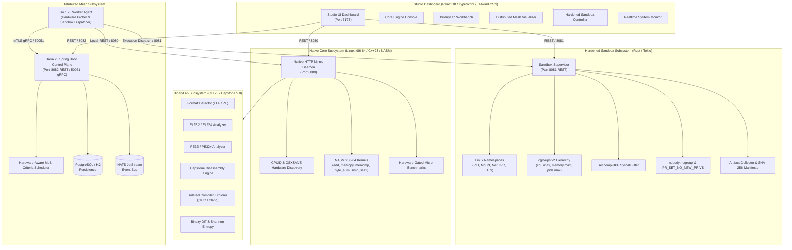
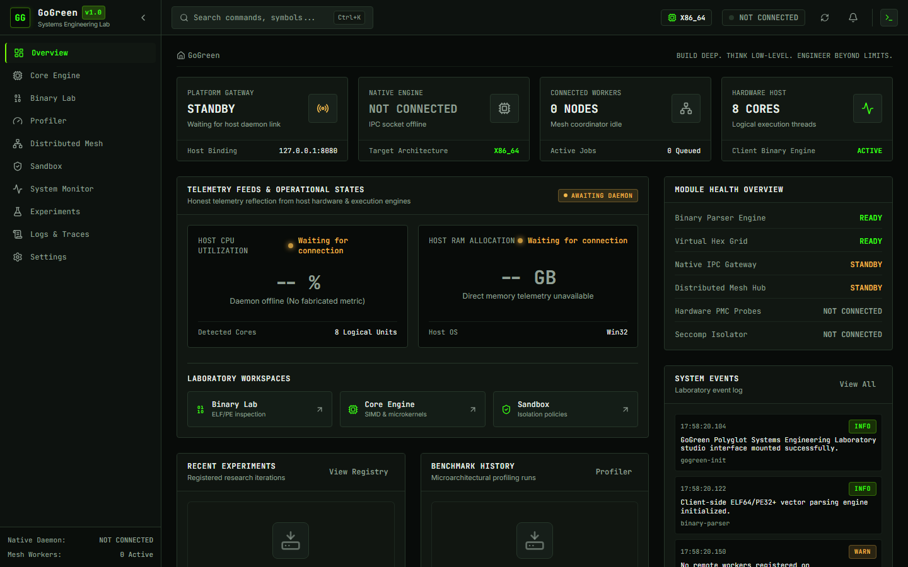
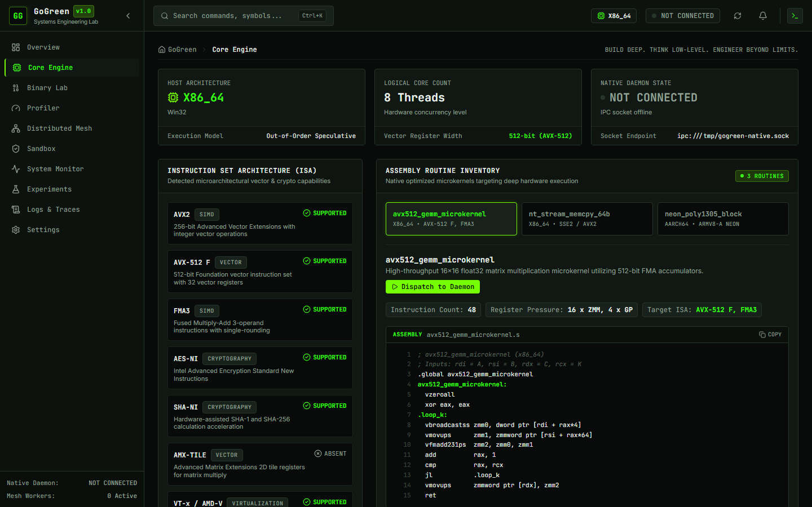
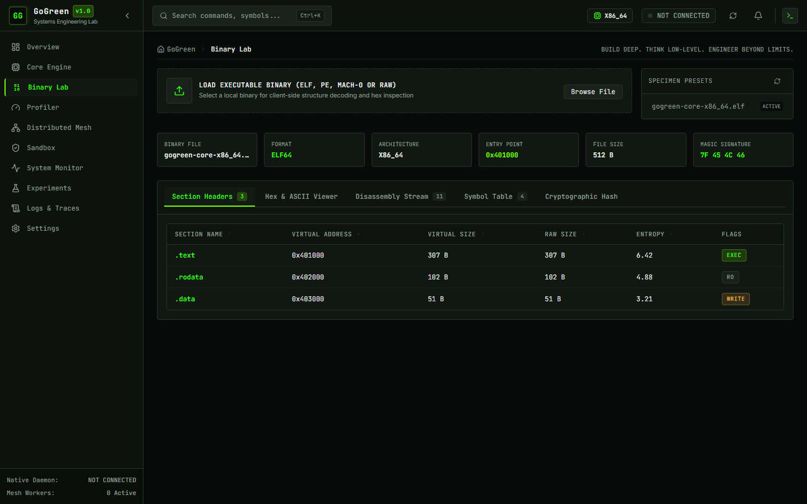
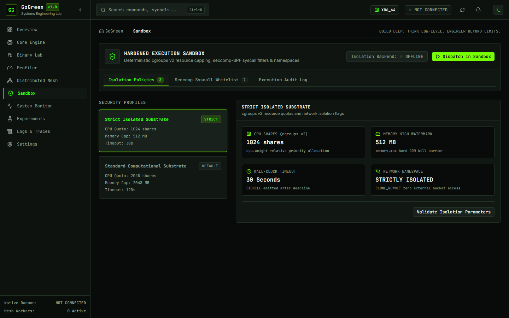
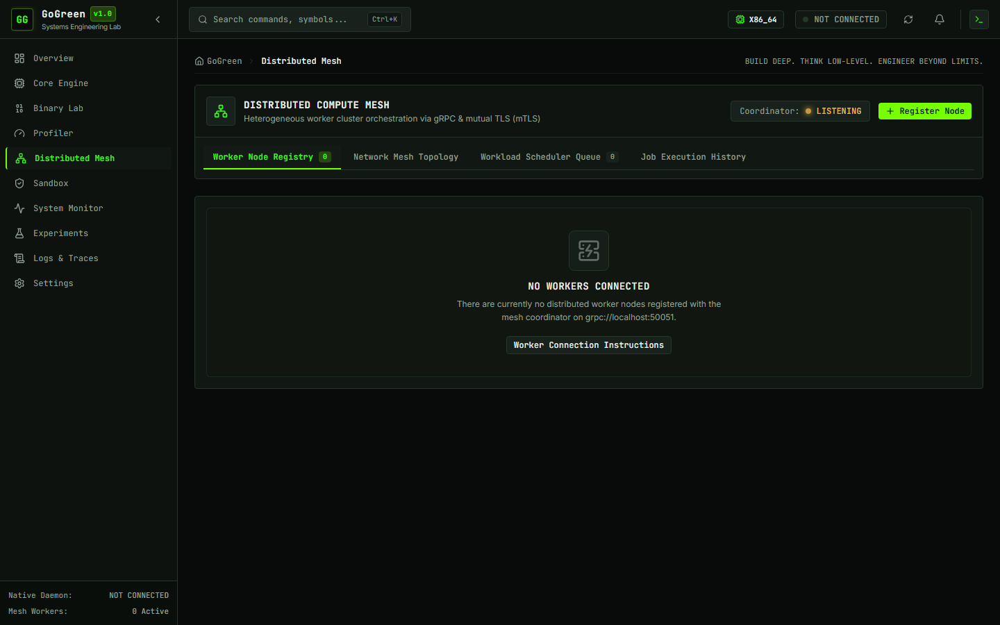
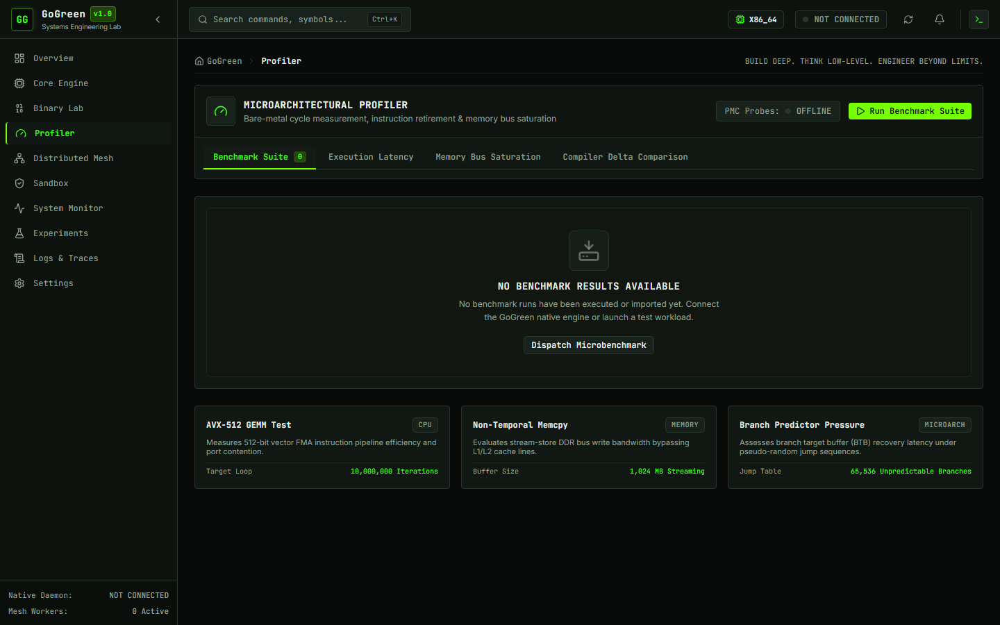
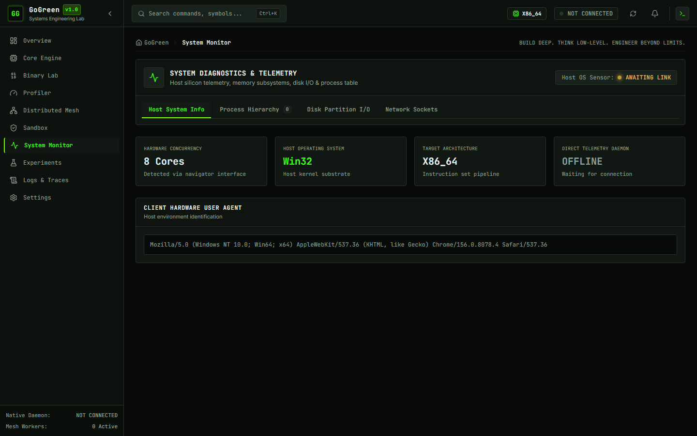

# GoGreen — Polyglot Systems Engineering Laboratory

<div align="center">

```
  ██████╗  ██████╗  ██████╗ ██████╗ ███████╗███████╗███╗   ██╗
 ██╔════╝ ██╔═══██╗██╔════╝ ██╔══██╗██╔════╝██╔════╝████╗  ██║
 ██║  ███╗██║   ██║██║  ███╗██████╔╝█████╗  █████╗  ██╔██╗ ██║
 ██║   ██║██║   ██║██║   ██║██╔══██╗██╔══╝  ██╔══╝  ██║╚██╗██║
 ╚██████╔╝╚██████╔╝╚██████╔╝██║  ██║███████╗███████╗██║ ╚████║
  ╚═════╝  ╚═════╝  ╚═════╝ ╚═╝  ╚═╝╚══════╝╚══════╝╚═╝  ╚═══╝
```

### **BUILD DEEP. THINK LOW-LEVEL. ENGINEER BEYOND LIMITS.**

[](https://en.cppreference.com/w/cpp/23)
[](https://www.nasm.us/)
[](https://www.rust-lang.org/)
[](https://go.dev/)
[](https://openjdk.org/)
[](https://www.typescriptlang.org/)
[](https://grpc.io/)
[](https://www.postgresql.org/)
[](https://nats.io/)

*An industrial-grade, multi-tier systems engineering laboratory integrating raw x86-64 assembly kernels, C++23 micro-engines, deep ELF/PE binary analysis, a hardened multi-tier Linux isolation supervisor written in Rust, and a distributed mesh orchestrated by Go worker agents and a Java 25 control plane.*

---

</div>

## 1. System Overview

**GoGreen** is engineered from the silicon up to modern distributed control planes. Built with an industrial, high-density visual interface inspired by NVIDIA design systems, GoGreen rejects superficial abstraction layers in favor of genuine low-level hardware discovery, strict boundary isolation, and deterministic systems programming.

### Core Capabilities:
- **Direct Silicon Discovery:** Real-time CPU topology, CPUID instruction execution, and OSXSAVE feature gating for AVX-512, AVX2, SSE4.2, and AES-NI extensions.
- **Hand-Crafted NASM Assembly Kernels:** Unrolled 64-bit and 128-bit vector routines (`memcpy`, `memcmp`, `byte_sum`, SSE2 SIMD) benchmarked against compiler-optimized C++23.
- **BinaryLab Reverse Engineering:** Pure C++23 parsers for ELF32/ELF64 and PE32/PE32+ formats, symbol/relocation resolution, Shannon byte entropy analysis, Capstone v5.0 disassembly, and an isolated Compiler Explorer.
- **Hardened Multi-Tier Linux Sandbox:** Custom Tokio-based Rust supervisor implementing Linux namespaces (`PID`, `Mount`, `Net`, `IPC`, `UTS`), ephemeral `cgroups v2` hierarchies, strict `seccomp-BPF` syscall filtering, resource ceilings, and unprivileged execution (`nobody:nogroup`).
- **Distributed Mesh Subsystem:** Bidirectional gRPC streaming protocol connecting autonomous Go 1.23 worker agents to a high-throughput Java 25 / Spring Boot control plane with hardware-aware scheduling, PostgreSQL state persistence, and NATS JetStream event streaming.
- **Industrial Studio Dashboard:** Ultra-responsive React 18 + Tailwind CSS interface rendering live hardware telemetry, interactive disassemblies, live benchmark execution, and sandbox workbench monitors.

---

## 2. Polyglot Architecture & Technology Matrix



### Technology Matrix & Layer Rationale

| Layer | Language / Framework | Subsystem | Responsibility & Justification |
| :--- | :--- | :--- | :--- |
| **Hardware / Vector** | **NASM x86-64** | `native/asm-kernels` | Direct register management (`rax`, `rcx`, `rdx`, `rsi`, `rdi`), unrolled vector kernels, zero compiler overhead. |
| **Native Core** | **C++23** | `native/core-engine` | High-performance CPUID instruction execution, `/proc` telemetry scraping, micro-benchmarking daemon on port 8080. |
| **Binary Analysis** | **C++23** + **Capstone 5.0** | `native/binary-lab` | Struct-level ELF/PE parsing, Capstone machine code disassembly, Shannon entropy profiling, sandboxed compiler invocation. |
| **Hardened Sandbox** | **Rust 2021** (Tokio, Nix) | `services/sandbox-manager` | Memory-safe supervisor implementing cgroups v2, Linux namespaces, seccomp-BPF whitelist, and unprivileged execution. |
| **Worker Agent** | **Go 1.23** | `services/worker-agent` | Lightweight daemon collecting host metrics, maintaining mTLS gRPC streams to control plane, and managing local supervisors. |
| **Control Plane** | **Java 25** + **Spring Boot 3.4** | `services/control-plane` | High-concurrency Netty gRPC server (port 50051), REST API (port 8082), hardware-aware scheduling, JPA persistence, NATS JetStream. |
| **Studio Dashboard** | **React 18** + **TypeScript** | `src/` | Industrial green dark-mode dashboard (port 5173), high-density layout, real-time hardware telemetry and interactive workbenches. |

---

## 3. Visual Gallery

The GoGreen Studio provides ten dedicated operational workspaces:

### Studio Overview & Cluster Dashboard

*High-density telemetry dashboard displaying cluster status, active workers, CPU frequency, memory allocation, and live node states.*

### Native Core Engine & Hardware Inspector

*Silicon-level hardware discovery showing raw CPUID stepping, vendor signatures, instruction set availability, and live assembly kernel benchmarks.*

### BinaryLab Executable Inspection & Disassembly

*Deep executable inspection workbench with ELF/PE header parsing, section maps, symbol tables, Shannon byte entropy charts, and Capstone disassembly.*

### Hardened Execution Sandbox Workbench

*Real-time supervisor console tracking multi-tier Linux isolation (Namespaces, cgroups v2, seccomp-BPF), exit statuses, and cryptographic manifests.*

### Distributed Mesh Visualizer

*Live mesh topology visualizer showing registered worker nodes, partition assignments, gRPC stream latencies, and active job queues.*

### Micro-Benchmark Profiler

*Comparative micro-benchmark suite executing hand-crafted NASM assembly vs compiler-optimized C++23 algorithms.*

### Realtime System Telemetry Monitor

*Host load average curves, memory buffers/cache allocations, and hardware resource saturation metrics.*

---

## 4. Phase-by-Phase Implementation Status

All capabilities through Phase 5 have been engineered, tested, verified, and integrated into the repository:

### Completed & Fully Operational Subsystems (Phases 0–5)

- **Phase 0 & 1 — Master Architecture & Complete Studio UI**
  - Architecture specifications, UI design tokens, and industrial visual identity.
  - Complete 10-page Studio dashboard: Overview, Core Engine, BinaryLab, Profiler, Distributed Mesh, Sandbox, System Monitor, Experiments, Logs, and Settings.
  - Full TypeScript models, test coverage, and responsive layouts.

- **Phase 2 — Native Core Engine & NASM SIMD Kernels**
  - Native C++23 micro-engine daemon running on port 8080.
  - CPUID hardware instruction execution and OSXSAVE/XCR0 feature gating.
  - Hand-crafted NASM kernels: `asm_add`, `asm_memcpy`, `asm_memcmp`, `asm_byte_sum`, and `asm_simd` (128-bit SSE2).
  - High-precision hardware micro-benchmarking engine with automated verification against C++ fallbacks.

- **Phase 3 — Distributed Mesh Protocol, Worker Agent & Control Plane**
  - Canonical Protobuf v1 contracts (`coordinator.proto`, `worker.proto`, `heartbeat.proto`, `job.proto`, `telemetry.proto`).
  - Go 1.23 worker agent with automated hardware probing and gRPC streaming.
  - Java 25 / Spring Boot 3.4 control plane with Netty gRPC server on port 50051.
  - Mutual TLS (mTLS) certificate generation and cryptographic authentication.

- **Phase 3.5 — Distributed Scheduler, Persistence & Event Processing**
  - Multi-criteria hardware-aware scheduler balancing ISA requirements, load factors, and active job quotas.
  - Relational database schema with Flyway migrations (`mesh_workers`, `mesh_jobs`, `mesh_telemetry_events`).
  - NATS JetStream integration for distributed event publishing and state transitions.

- **Phase 4 — Advanced Binary Engineering (BinaryLab)**
  - C++23 format detector supporting ELF32, ELF64, PE32, and PE32+.
  - Capstone Engine v5.0.9 disassembly module decoding raw instructions into mnemonic representations.
  - Section table analysis, symbol table parsing (`.symtab`, `.dynsym`), and relocation extractors.
  - Shannon byte entropy profiling and binary diff engine.
  - Sandboxed Compiler Explorer invoking GCC/Clang with strict execution timeouts.

- **Phase 5 — Hardened Execution Sandbox Supervisor**
  - Rust Tokio supervisor service running on port 8081.
  - Linux Namespaces isolation (`PID`, `Mount`, `Net`, `IPC`, `UTS`).
  - Ephemeral cgroups v2 controller hierarchy (`cpu.max`, `memory.max`, `pids.max`).
  - seccomp-BPF whitelist filter blocking dangerous syscalls (`ptrace`, `bpf`, `chroot`, raw sockets).
  - Privilege drop to `nobody:nogroup` with `PR_SET_NO_NEW_PRIVS = 1`.
  - Bounded stdout/stderr capture and SHA-256 execution artifact manifests.

### Roadmap (Future Phases)

- **Phase 6 — Distributed Consensus & Multi-Region Clustering**
  - Raft-based distributed consensus across control-plane coordinators.
  - Cross-region partition failover and quorum state replication.
- **Phase 7 — Dynamic Binary Instrumentation (DBI) & Hardware Performance Counters**
  - Integration with Linux `perf_event_open` for hardware cache miss and branch misprediction profiling.
  - Dynamic instruction patching and live hook injection.
- **Phase 8 — Autonomous Fault Recovery & Self-Healing Mesh**
  - Automated worker evacuation, stale lease reclamation, and circuit breaker heuristics.
- **Phase 9 — Global Heterogeneous Compute Fabric**
  - Multi-ISA federation across x86-64, ARM64, and RISC-V nodes.

---

## 5. Quickstart & Local Setup

### 5.1 Prerequisites
- **Operating System:** Windows 11 with WSL2 (Linux kernel 6.6+) or native Linux (Ubuntu 24.04+).
- **Core Toolchains:**
  - `clang++-18` or `g++-14` (C++23)
  - `nasm` (>= 2.16)
  - `cmake` (>= 3.28)
  - `capstone` (>= 5.0)
  - `go` (>= 1.23)
  - `java` (OpenJDK 25-ea or 21 LTS) & `mvn` (>= 3.9)
  - `rustc` & `cargo` (>= 1.84)
  - `node` (>= 20.x) & `npm` (>= 10.x)

For step-by-step toolchain configuration, see the [Local Development Guide](file:///c:/Projects/AYUSHCMD-GITHUB/go-green/docs/LOCAL_DEVELOPMENT.md).

### 5.2 Clone & Configure
```bash
# Clone the repository
git clone https://github.com/ayushcmd/go-green.git
cd go-green

# Create local environment configuration
cp .env.example .env
```

### 5.3 Quickstart: Studio UI (Standalone Mode)
To immediately explore the Studio interface in development mode:
```bash
npm install
npm run dev
```
Open [http://localhost:5173](http://localhost:5173) in your browser.

### 5.4 Starting the Native Engine & Services
To run the live polyglot backend components:

```bash
# 1. Build and launch Native C++ Daemon (WSL2 / Linux)
cd native
mkdir -p build && cd build
cmake -DCMAKE_BUILD_TYPE=Release ..
cmake --build . -j$(nproc)
./core-engine/gogreen-daemon --port 8080 &

# 2. Launch Rust Sandbox Supervisor (WSL2 / Linux with cgroups v2)
cd ../../services/sandbox-manager
cargo run --release &

# 3. Launch Java Control Plane Coordinator
cd ../control-plane
mvn spring-boot:run &

# 4. Launch Go Worker Agent
cd ../worker-agent
go run ./cmd/worker-agent &
```

---

## 6. Verification & Test Execution

Run the comprehensive test suites across the polyglot stack:

```bash
# Studio Frontend Tests (Vitest)
npm test -- --run

# Go Worker Agent Tests (Go)
cd services/worker-agent && go test -v ./... && cd ../..

# Java Control Plane Tests (Maven)
cd services/control-plane && mvn test && cd ../..

# Native Engine & Kernels Tests (GoogleTest)
cd native/build && ctest --output-on-failure && cd ../..

# Rust Sandbox Supervisor Tests (Cargo)
cd services/sandbox-manager && cargo test && cd ../..
```

---

## 7. Project Structure

```
go-green/
├── contracts/protobuf/        # Protobuf v1 contracts (coordinator, worker, job, etc.)
├── docs/                      # Architectural specs, API reference, security models
│   ├── assets/                # Studio UI screenshots & diagrams
│   ├── ARCHITECTURE.md        # Deep architectural specification & sequence diagrams
│   ├── LOCAL_DEVELOPMENT.md   # Toolchains, build commands & troubleshooting
│   ├── API_REFERENCE.md       # Full HTTP REST & gRPC endpoint documentation
│   └── SECURITY.md            # Security architecture, threat model & sandbox isolation
├── native/                    # C++23 & NASM native subsystems
│   ├── asm-kernels/           # Hand-crafted x86-64 NASM SIMD kernels
│   ├── core-engine/           # CPUID, load monitor, micro-benchmark daemon
│   └── binary-lab/            # ELF/PE parser, Capstone disassembler, compiler explorer
├── services/                  # Distributed microservices
│   ├── control-plane/         # Java 25 / Spring Boot 3.4 gRPC coordinator
│   ├── worker-agent/          # Go 1.23 distributed worker daemon
│   └── sandbox-manager/       # Rust Tokio hardened Linux sandbox supervisor
├── src/                       # React 18 + TypeScript + Tailwind Studio UI
├── package.json               # Frontend dependencies & scripts
├── vite.config.ts             # Vite bundler configuration
└── .env.example               # Environment variables template
```

---

## 8. Documentation Index

- [Architecture Specification (`docs/ARCHITECTURE.md`)](file:///c:/Projects/AYUSHCMD-GITHUB/go-green/docs/ARCHITECTURE.md)
- [Local Development & Build Guide (`docs/LOCAL_DEVELOPMENT.md`)](file:///c:/Projects/AYUSHCMD-GITHUB/go-green/docs/LOCAL_DEVELOPMENT.md)
- [Complete API Reference (`docs/API_REFERENCE.md`)](file:///c:/Projects/AYUSHCMD-GITHUB/go-green/docs/API_REFERENCE.md)
- [Security Architecture & Threat Model (`docs/SECURITY.md`)](file:///c:/Projects/AYUSHCMD-GITHUB/go-green/docs/SECURITY.md)

---

## 9. Author & License

**Lead Architect & Systems Engineer:** Ayush (`ayushcmd`)  
**Academic / Institutional Email:** `ayush_24a12res897@iitp.ac.in`  
**GitHub Repository:** [https://github.com/ayushcmd/go-green](https://github.com/ayushcmd/go-green)

*Note: This repository is currently proprietary and all rights are reserved by the author. No formal open-source license has been granted at this time.*
