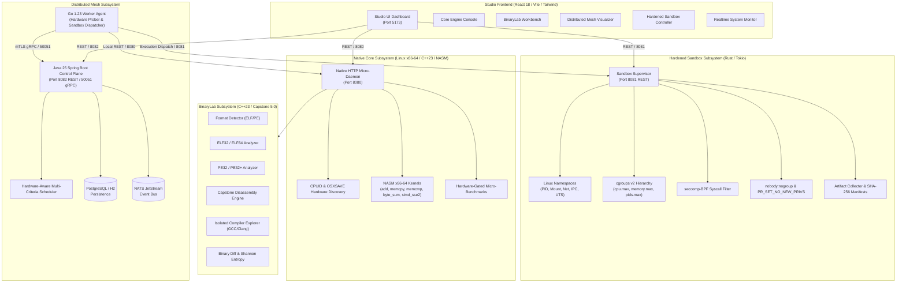
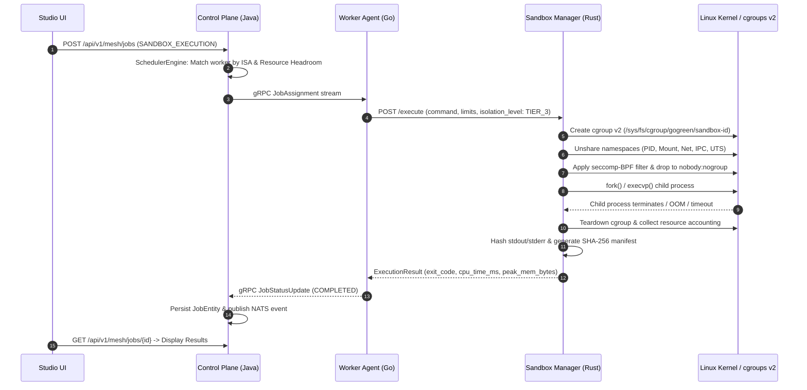

# GoGreen Architecture Specification

> **BUILD DEEP. THINK LOW-LEVEL. ENGINEER BEYOND LIMITS.**

---

## 1. System Overview

GoGreen is a **Polyglot Systems Engineering Laboratory** engineered from the silicon layer up to modern distributed control planes. It combines low-level hardware discovery, hand-crafted x86-64 NASM assembly kernels, C++23 native micro-engines, deep ELF/PE binary analysis and disassembly, a hardened multi-tier Linux isolation supervisor written in Rust, and a distributed mesh orchestrated by Go worker agents and a Java 25 / Spring Boot control plane.



---

## 2. Polyglot System Boundaries & Rationale

GoGreen deliberately rejects the "one-size-fits-all" language paradigm, employing the optimal language and toolchain for each engineering layer:

| Subsystem | Language & Toolchain | Engineering Justification |
| :--- | :--- | :--- |
| **Assembly Kernels** | **NASM x86-64** (Intel syntax) | Direct hardware instruction control, register allocation (`rax`, `rcx`, `rdx`, `rsi`, `rdi`), zero compiler runtime overhead, unrolled SIMD vectorization. |
| **Native Core Engine** | **C++23** (`clang++-18` / `g++-14`) | High-performance CPUID instruction execution, bitwise feature extraction, strict bounds validation, and zero-allocation execution. |
| **BinaryLab** | **C++23** + **Capstone v5.0** | Byte-level ELF/PE parsing, direct struct mapping (`Elf64_Ehdr`, `IMAGE_DOS_HEADER`), Capstone memory-safe instruction decoding, and Shannon entropy analysis. |
| **Hardened Sandbox** | **Rust 2021** (`tokio`, `nix`) | Memory-safe systems programming, low-overhead Linux syscall manipulation (`clone`, `unshare`, `setrlimit`, `prctl`, seccomp-BPF), robust async task lifecycle. |
| **Distributed Worker** | **Go 1.23** (`grpc-go`, `protobuf`) | Minimal static footprint, low-latency concurrent event loops, native POSIX syscall bindings, seamless gRPC streaming. |
| **Mesh Control Plane** | **Java 25** (`Spring Boot 3.4`, `Netty`) | Robust enterprise concurrency, high-throughput Netty gRPC server, declarative transactions, JPA/Hibernate persistence, pluggable scheduling algorithms. |
| **Studio UI** | **React 18** + **TypeScript** + **Tailwind** | Responsive, reactive visualization, type-safe contract mirrors, real-time hardware telemetry streams, industrial dark/bright-green theme. |

---

## 3. Subsystem Architecture

### 3.1 Native Core Engine & Assembly Kernels (`native/`)
- **Micro-Engine Daemon:** Standalone POSIX HTTP server running on `127.0.0.1:8080`, supporting endpoints for CPU identification, system load parsing (`/proc/meminfo`, `/proc/loadavg`), and hardware-calibrated micro-benchmarks.
- **Hardware Feature Gating:** Uses raw x86-64 `cpuid` assembly instructions combined with `xgetbv` (OSXSAVE check) to prevent illegal instruction crashes (`SIGILL`) before running AVX-512, AVX2, or SSE routines.
- **Assembly Kernels:**
  - `asm_add`: 64-bit register addition.
  - `asm_memcpy`: Unrolled 64-bit word block memory copy.
  - `asm_memcmp`: Fast register comparison.
  - `asm_byte_sum`: Vectorized accumulator.
  - `asm_simd`: 128-bit SSE2 (`paddd`) parallel integer addition.
  - C++ fallbacks: Provided in `asm_fallbacks.cpp` when compiled on non-x86 architectures.

### 3.2 BinaryLab Subsystem (`native/binary-lab/`)
- **Format Detection:** Magic byte validation (`0x7F 'E' 'L' 'F'` for ELF, `'M' 'Z'` for PE).
- **ELF Parser:** Parses ELF32 and ELF64 headers, program headers (`PT_LOAD`, `PT_DYNAMIC`), section headers (`.text`, `.data`, `.bss`, `.rodata`), and symbol tables (`.symtab`, `.dynsym`).
- **PE Parser:** Parses MS-DOS stub, PE signature, COFF File Header, Optional Header (PE32 / PE32+), Section Table, and Data Directories (Import / Export / Relocation tables).
- **Capstone Disassembler:** Integrates Capstone Engine v5.0.9 to disassemble raw executable buffers into structured instruction streams with mnemonics, operands, and byte sequences.
- **Compiler Explorer:** Sandboxed compiler driver invoking `g++` or `clang++` via isolated `fork`/`execvp` with strict timeout controls to produce assembly output from C++ source snippets.
- **Shannon Entropy & Diff:** Computes byte entropy across 256-byte windows to detect packed/encrypted payloads, and provides section-by-section binary comparison.

### 3.3 Distributed Mesh Subsystem (`services/`)
- **Protobuf v1 Contracts (`contracts/protobuf/`):**
  - `coordinator.proto`: Defines bidirectional streaming RPC `Connect` between worker nodes and coordinator.
  - `worker.proto`: Worker registration schemas with hardware capabilities, ISA sets, core counts, and memory specs.
  - `heartbeat.proto`: Telemetry heartbeat carrying CPU utilization, load averages, memory consumption, active job counts, and status flags.
  - `job.proto`: Job definitions supporting `CPU_INFORMATION`, `SYSTEM_TELEMETRY`, `NATIVE_BENCHMARK_SUITE`, and `SANDBOX_EXECUTION`.
- **Go Worker Agent (`services/worker-agent`):**
  - Connects to Java Control Plane over gRPC (with optional mTLS).
  - Collects local hardware metrics directly from `/proc` and the native C++ daemon.
  - Dispatches tasks to local workers or the Rust Sandbox Supervisor.
- **Java Control Plane (`services/control-plane`):**
  - Netty gRPC server listening on `0.0.0.0:50051`.
  - Spring Boot REST API listening on `0.0.0.0:8082`.
  - JPA repository layer with Flyway schema migration (`mesh_workers`, `mesh_jobs`, `mesh_telemetry_events`).
  - NATS JetStream event publishing for worker state transitions and job events.

### 3.4 Hardware-Aware Scheduling Engine
The Java `SchedulerEngine` evaluates worker eligibility across multiple criteria:
1. **Health State:** Worker status must be `HEALTHY` or `BUSY` (heartbeat received within timeout threshold).
2. **ISA Compatibility:** Jobs requiring specific SIMD extensions (e.g., AVX-512, AVX2, SSE4.2) are filtered against worker CPUID flags.
3. **Resource Capacity:**
   - Free memory must exceed job requirements.
   - CPU load factor must be below threshold.
   - Active concurrent jobs must be strictly less than worker `max_concurrent_jobs`.
4. **Load Balancing:** When multiple workers are eligible, the scheduler selects the worker with the lowest active load ratio:
   $$\text{Load Factor} = \frac{\text{Active Jobs}}{\text{Max Concurrent Jobs}} \times 0.6 + \left(\frac{\text{CPU Usage \%}}{100}\right) \times 0.4$$

### 3.5 Hardened Execution Sandbox (`services/sandbox-manager`)
Written in Rust with Tokio, implementing four configurable isolation tiers:

```
[Tier 0: Direct Process]   -> Basic rlimits (fallback for local dev)
[Tier 1: Basic Isolation]  -> POSIX rlimits + unprivileged nobody execution + bounded stdout/stderr
[Tier 2: Standard Sandbox] -> Tier 1 + Linux Namespaces (PID, Mount, IPC, UTS) + cgroups v2
[Tier 3: Hardened Strict]  -> Tier 2 + Network Namespace (no network) + seccomp-BPF whitelist
```

- **Linux Namespaces:** `CLONE_NEWPID` isolates child PID tree; `CLONE_NEWNS` isolates filesystem mounts; `CLONE_NEWNET` provides loopback-only or completely empty network stack; `CLONE_NEWIPC` isolates shared memory; `CLONE_NEWUTS` sets custom hostname.
- **cgroups v2:** Dynamically creates ephemeral cgroup controllers per execution under `/sys/fs/cgroup/gogreen/sandbox-<uuid>`:
  - `cpu.max`: Restricts maximum CPU quota (e.g., `80000 100000` = 80%).
  - `memory.max`: Strict memory ceiling (e.g., 128 MB). Out-of-memory triggers kernel OOM killer caught by supervisor.
  - `pids.max`: Prevents fork bombs (e.g., max 32 processes).
- **seccomp-BPF:** Installs a Berkeley Packet Filter blocking dangerous syscalls (`ptrace`, `bpf`, `sys_chroot`, `unshare`, `clone3`, `mount`, network sockets in Tier 3).
- **Privilege Dropping:** Sets `PR_SET_NO_NEW_PRIVS = 1` and drops credentials to UID `65534` (`nobody`) / GID `65534` (`nogroup`).
- **Disk Bounding & Artifact Manifests:** Caps stdout/stderr to 2 MB buffer; writes execution metadata, timings, exit status, and SHA-256 manifests to bounded disk storage.

---

## 4. Execution Lifecycle



---

## 5. Security Architecture & Threat Boundaries

1. **Host Boundary:** The Windows host runs the React Studio UI and developer tools. The execution engine runs in WSL2/Linux kernel environment.
2. **Supervisor Boundary:** The Rust Sandbox Supervisor runs with supervisor privileges to configure namespaces and cgroups, but executes all child commands under unprivileged user contexts (`nobody`).
3. **Child Boundary:** The untrusted binary runs inside an ephemeral cgroup, unshared namespaces, and seccomp-BPF filter with no network access, preventing any host file modification or lateral network movement.
4. **Mesh Boundary:** Workers communicate with the coordinator via mTLS (mutual TLS) using x509 certificates and hardware fingerprints to prevent spoofing or unauthorized task injection.

---

*For detailed API contracts, refer to [API_REFERENCE.md](file:///c:/Projects/AYUSHCMD-GITHUB/go-green/docs/API_REFERENCE.md).*  
*For developer setup instructions, refer to [LOCAL_DEVELOPMENT.md](file:///c:/Projects/AYUSHCMD-GITHUB/go-green/docs/LOCAL_DEVELOPMENT.md).*  
*For security model details, refer to [SECURITY.md](file:///c:/Projects/AYUSHCMD-GITHUB/go-green/docs/SECURITY.md).*
