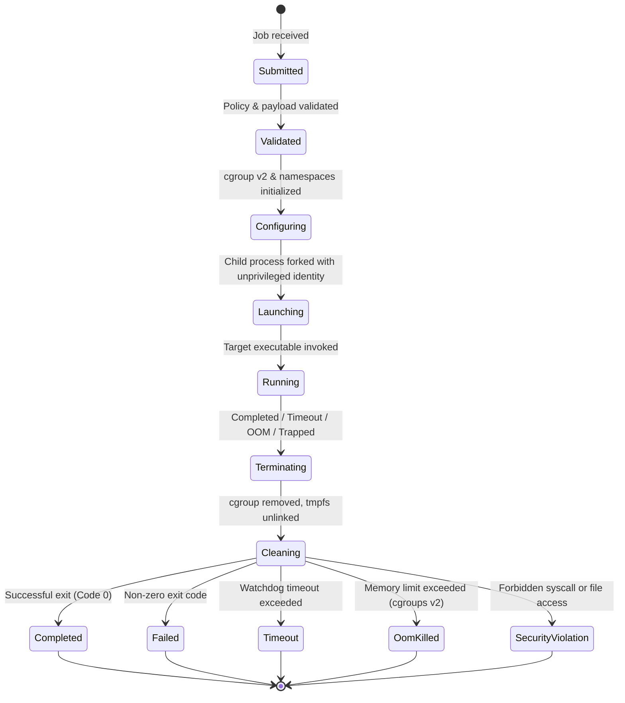

# GoGreen Sandbox Execution Lifecycle

## 1. Lifecycle State Machine

Every execution managed by the Rust Sandbox Supervisor progresses through a strictly monitored state machine:

---

## 2. Execution Phases & Recovery Guarantees

1. **Validation Phase:**
   - Parameter integrity check: binary path exists, memory cap $\ge 16\text{MB}$, timeout $> 0$, command is on approved workload list.
   - If invalid, state transitions directly to `Failed` with structured rejection reason.

2. **Configuration Phase:**
   - Unique execution UUID generated: `sandbox_<uuid>`.
   - cgroups v2 leaf created: `/sys/fs/cgroup/gogreen/sandbox_<uuid>/`.
   - Limits applied: `memory.max`, `memory.swap.max`, `cpu.max`, `pids.max`.

3. **Launch Phase:**
   - POSIX pipes initialized for stdout/stderr with non-blocking mode.
   - Process spawned via `clone` with isolation flags:
     `CLONE_NEWPID | CLONE_NEWNS | CLONE_NEWNET | CLONE_NEWIPC | CLONE_NEWUTS`.
   - PID assigned to cgroup: `/sys/fs/cgroup/gogreen/sandbox_<uuid>/cgroup.procs`.
   - Drop privileges to unprivileged UID (65534).
   - Apply Seccomp-BPF and Landlock rules before `execve`.

4. **Monitoring & Watchdog Phase:**
   - Asynchronous Tokio event loop polls child process exit, stdout, stderr, and cancellation signal.
   - Output buffer caps applied: stream reading halts if buffer reaches `max_output_bytes` (1MB).
   - Watchdog timer triggers `SIGTERM` if process exceeds `timeout_ms`. If process does not exit within 500ms, `SIGKILL` is issued.

5. **Cleanup & Artifact Phase:**
   - Process waitpid reaped (preventing zombies).
   - cgroup directory deleted.
   - Temporary mount directory unlinked.
   - Execution report sealed with peak memory, CPU time, exit code, and SHA-256 output digests.
